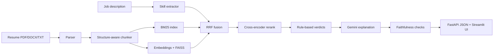

# AI Resume Intelligence & Job Matching

Upload a resume, paste a job description, and get an evidence-backed skill analysis: which required skills are demonstrated, which are only listed, which are missing, and the exact resume passage behind every verdict.

It is a retrieval system first and a chatbot never. The LLM explains verdicts; it does not decide them.

## Architecture



## Features

- Resume parsing: PDF, DOCX, and TXT.
- Hybrid retrieval using BM25 and dense embeddings.
- FAISS vector search.
- Reciprocal Rank Fusion (RRF).
- Cross-encoder reranking.
- Evidence-backed skill matching.
- Rule-based skill verdicts: demonstrated, partial, or missing.
- Google Gemini explanations with a template fallback.
- FastAPI backend and Streamlit user interface.
- Offline testing and retrieval evaluation.

## Project Structure

app/
  ingestion/
    parser.py
    chunker.py
  retrieval/
    bm25.py
    embedder.py
    vector_store.py
    hybrid.py
    reranker.py
  analysis/
    skills.py
    matcher.py
    llm.py
  evaluation/
    metrics.py
    faithfulness.py
    run_eval.py
  api/
    main.py
    schemas.py
  pipeline.py

ui/
  streamlit_app.py

data/
  skills_taxonomy.json
  samples/
  eval/
    retrieval_eval.json

tests/

## Key Design Decisions

| Decision | Reason |
|---|---|
| Bullet-level chunks | Provides precise resume evidence. |
| Hybrid retrieval | Combines exact keyword matching with semantic search. |
| Cross-encoder reranking | Improves the ranking of relevant passages. |
| Deterministic verdicts | Makes skill assessments reproducible and testable. |
| Faithfulness checks | Ensures verdicts and citations are supported by evidence. |
| Template fallback | Allows analysis to continue when the LLM fails. |

## Run Locally

Create a virtual environment:

```bash
python -m venv .venv
```

Activate it on Linux/macOS:

```bash
source .venv/bin/activate
```

Install dependencies:

```bash
pip install -r requirements-dev.txt
```

Configure environment variables:

```bash
cp .env.example .env
```

Add your GEMINI_API_KEY to `.env` if you want AI-generated explanations.

Run the Streamlit application:

```bash
streamlit run ui/streamlit_app.py
```

Run the FastAPI backend:

```bash
uvicorn app.api.main:app --reload
```

API documentation:

http://localhost:8000/docs

## API Usage

```bash
curl -X POST http://localhost:8000/analyze \
  -F resume=@resume.pdf \
  -F "job_description=$(cat data/samples/jd_data_scientist.txt)" \
  -F target_role="Junior Data Scientist"
```

## Tests and Evaluation

Run tests:

```bash
pytest -q
```

Run retrieval evaluation:

```bash
python -m app.evaluation.run_eval
```

Metrics include Recall@1, Recall@3, Recall@5, and Mean Reciprocal Rank (MRR).

## Deployment

1. Push the project to GitHub.
2. Open Render and select New → Blueprint.
3. Select the repository containing `render.yaml`.
4. Configure `GEMINI_API_KEY` in the Render dashboard.
5. Deploy using an instance with at least 1 GB of memory.

## Known Limitations

- Skill extraction depends on the configured taxonomy.
- Scanned PDFs do not have OCR support.
- Two-column PDFs may have text-ordering issues.
- Matching weights and semantic thresholds require calibration.

## Future Improvements

- Embedding-based discovery of unknown skills.
- Resume improvement suggestions tailored to job descriptions.
- User feedback to improve skill verdicts.
- Expanded evaluation using anonymized resumes.
